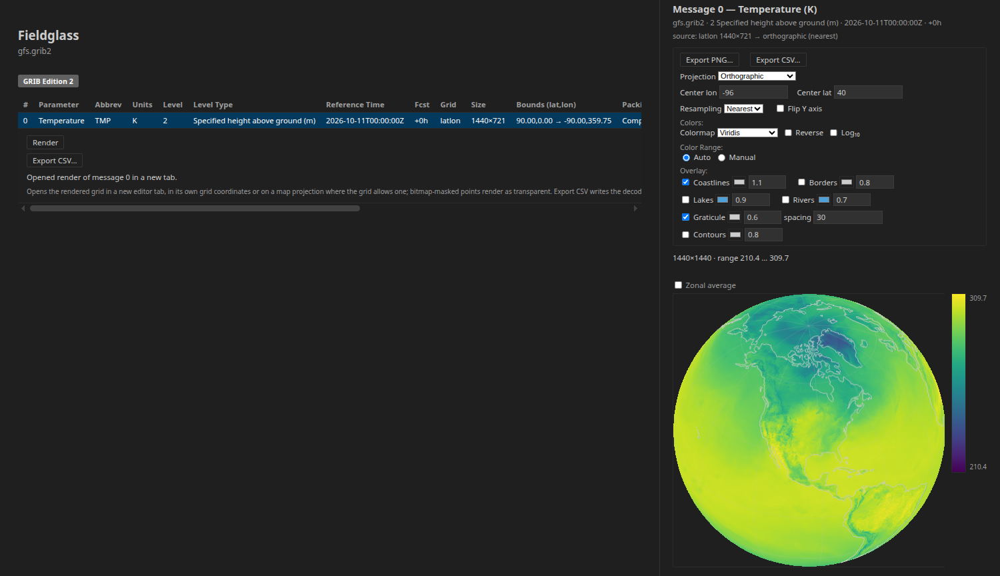

# Fieldglass

Weather and climate data comes in a few common formats: GRIB from forecast
centers, NetCDF from research and climate models, and Zarr for large datasets
kept in the cloud. Fieldglass opens all of them and draws their fields as
maps. Every decoder is written from scratch in Rust, with no C libraries, so
the same code runs in a VS Code extension, in your own Rust program, and in a
web page. It decodes every GRIB2 packing the WMO defines, with no build flags,
and turns spherical-harmonic (spectral) fields back into a map.

[Latest release](https://github.com/D0ubleD0uble/fieldglass/releases/latest)

## Three ways in

### In VS Code

The Fieldglass extension opens a GRIB or NetCDF file, or a Zarr store, and
shows what's in it: every message listed with its parameter, level and time,
and any field drawn as a map you can reproject, probe and contour. There's
nothing else to install, because it ships a prebuilt binary for each platform.
Install it from the
[Marketplace](https://marketplace.visualstudio.com/items?itemName=fieldglass.fieldglass),
or search for "Fieldglass" in the Extensions view. The
[extension's page](extension/README.md) covers what it opens, the render
panel, its limits, and installing by hand.

### From Rust

Eight library crates are published to crates.io with each stable release. Start
from [`fieldglass`](https://crates.io/crates/fieldglass). It sits above the
readers, reaches GRIB, NetCDF and Zarr, and hands back plain data, so your
program doesn't have to take a format crate directly. Each reader is also
usable on its own and links nothing the others need
([ADR-0010](docs/decisions/0010-a-common-array-model-and-containers-as-drivers.md)).

| Crate | Use it to |
|---|---|
| [`fieldglass`](https://crates.io/crates/fieldglass) | Open any supported file or store, decode a field, place it on the Earth and draw it |
| [`fieldglass-grib1`](https://crates.io/crates/fieldglass-grib1) | Read GRIB edition 1 |
| [`fieldglass-grib2`](https://crates.io/crates/fieldglass-grib2) | Read GRIB edition 2 |
| [`fieldglass-netcdf`](https://crates.io/crates/fieldglass-netcdf) | Read NetCDF classic and NetCDF-4 (HDF5) |
| [`fieldglass-zarr`](https://crates.io/crates/fieldglass-zarr) | Read Zarr v2 and v3 stores |
| [`fieldglass-fetchplan`](https://crates.io/crates/fieldglass-fetchplan) | Work out which bytes of a remote file to fetch, from the index beside it |
| [`fieldglass-aec`](https://crates.io/crates/fieldglass-aec) | Decode CCSDS adaptive entropy coding (szip), which GRIB2 and HDF5 use |
| [`fieldglass-core`](https://crates.io/crates/fieldglass-core) | Share types between readers, or write your own reader |

A file is addressed in one of two ways, and Fieldglass tells you which. A GRIB
file is a list of self-describing messages, so a message's position is its
whole address. NetCDF and Zarr hold named variables over shared dimensions, so
a field is a variable, the two of its axes that make the picture, and where you
stand on the rest. `Session::addressing` says which kind it's holding.
Everything after a decode (render, probe, contours, combine, warp, palette)
takes a decoded field and works the same for both.

### In a web page

The browser build is published to npm as
[`@fieldglass/wasm`](https://www.npmjs.com/package/@fieldglass/wasm) with each
stable release, so a web page needs no Rust toolchain. It reads GRIB1, GRIB2
and NetCDF, with NetCDF adding about 30% to the bundle, and it's meant to run
in a Web Worker. A second entry,
`@fieldglass/wasm/full`, adds Zarr stores and a planner that works out which
byte ranges of a remote GRIB file to fetch from its `.idx` or `.index`
sidecar. In the browser, Rust hands the decoded values and a color table to
a GPU shader, which paints the map, with the CPU painter kept as the fallback
and as the reference the shader is checked against. Bundle sizes and decode
timings are in [`crates/fieldglass-wasm/README.md`](crates/fieldglass-wasm/README.md).

## What it reads

| Format | Read by | What it covers |
|---|---|---|
| GRIB1 | `fieldglass-grib1` | Every message's metadata, and values for every packing in the [GRIB1 table](#grib1-packing-modes) |
| GRIB2 | `fieldglass-grib2` | All eight sections, and values for every packing in the [GRIB2 table](#grib2-packing-modes) |
| NetCDF | `fieldglass-netcdf` | Classic (CDF-1, CDF-2, CDF-5) and NetCDF-4 / HDF5, with CF unpacking |
| Zarr | `fieldglass-zarr` | v2 and v3 stores, consolidated or not, sharded or not, and kerchunk references |

### GRIB grids and parameters

GRIB1 grids that are read and placed on the Earth: latitude and longitude,
Gaussian, polar stereographic, Lambert conformal, rotated latitude and
longitude (`grid_type 10`), and reduced (quasi-regular) latitude and longitude
and Gaussian. A message with no grid description is matched to the common
predefined global grids, ON388 Table B grids 2, 3 and 4. Stretched grids,
oblique Lambert, any other grid type and other predefined grid numbers are
reported as `unsupported`.

GRIB2 grid templates: regular latitude and longitude (3.0), rotated latitude
and longitude (3.1), Mercator (3.10), transverse Mercator (3.12), polar
stereographic (3.20), Lambert conformal (3.30), regular and reduced Gaussian
(3.40), Lambert azimuthal equal-area (3.140), space-view perspective (3.90),
spherical-harmonic coefficients (3.50), bi-Fourier spectral subdomains
(3.61–3.63), and HEALPix (3.150). Spherical-harmonic fields are turned back
into a latitude and longitude grid, and so are HEALPix fields, the equal-area
tiling ECMWF publishes its higher-resolution open data on, so both reproject,
probe, contour and export like any other grid. Bi-Fourier fields decode to
their coefficients only, so they aren't drawn.

GRIB2 product templates: 4.0, 4.8 and 4.11; the ensemble, derived,
probability, percentile, error and spatial-processing templates (4.1, 4.2,
4.5, 4.6, 4.7, 4.9, 4.10, 4.12 and 4.15), of which only the block they share
with 4.0 (parameter, level and forecast time) is read; and the chemistry and
aerosol templates with their constituent, size and wavelength ranges (4.40 to
4.48).

Each message is named from the WMO tables. GRIB2 ships the complete WMO Code
Table 4.2, 1,387 parameters across all 60 discipline and category tables,
generated from a pinned `wmo-im/GRIB2` release, with short names from the
abbreviations NCEP publishes for the same codes. Codes above 191 are local,
meaning whatever the originating center says, so three centers' own tables
ship alongside and apply only to files from that center: ECMWF (2,826
parameters, 13 of them tied to a declared local-table revision), DWD (213)
and NCEP (479). GRIB1 carries WMO ON388 Table 2 (versions 1 to 3) plus all 29
ECMWF local tables (center 98), from the IFS and ERA5 surface tables to the
aerosol, chemistry and ensemble-statistics ones, and files another center made
with ECMWF as sub-center read those tables too. Other centers' GRIB1 local
tables aren't included (ecCodes ships a few, in layouts its own reader
misreads), so a field from one is shown as `Parameter center/table/id`, naming
the codes. Originating centers for both editions come from the WMO Common Code
Tables, 309 for GRIB2 and 239 for GRIB1, with sub-centers resolved from the
center and sub-center codes together.

### NetCDF and HDF5

Classic NetCDF reads fully. For NetCDF-4, Fieldglass walks the HDF5 object
tree (groups, datasets, dataspaces, datatypes and attributes) and turns the
dimension-scale convention into named dimensions. It decodes contiguous,
compact and chunked storage, with the deflate, shuffle, fletcher32, zstd and
szip filters. Fletcher32 is a checksum, checked on read. Zstd is netcdf-c
4.9's recommended compressor for new climate archives, and a default netcdf-c
install often has no working zstd plugin, so decoding it in pure Rust reads
files that install can't. Szip is decoded with Fieldglass's own
`fieldglass-aec` crate.

Chunked storage covers the version-1 B-tree index and every version-4 index
(single-chunk, fixed-array, extensible-array for unlimited dimensions,
implicit, and v2-B-tree), each for filtered and unfiltered chunks, and the
version-5 layout message libhdf5 2.0 writes for a filtered variable. Values
are CF-unpacked: `scale_factor` and `add_offset` recover real units, and
`_FillValue`, `missing_value` and `valid_range` mark the gaps. Variables in
nested groups resolve too, with path-qualified names (`PRODUCT/qa_value`) and
dimensions looked up in parent groups, so grouped products such as Sentinel-5P
and GPM IMERG list and draw their variables.

Slices are placed on a regular latitude and longitude grid, on WRF `wrfout`
grids (Lambert, polar stereographic, Mercator or unrotated latitude and
longitude, from the `MAP_PROJ` global attributes), on GOES geostationary
imagery (from a CF `geostationary` grid mapping), and on curvilinear grids
that give a latitude and longitude for every cell, such as ocean models on a
tripolar mesh and satellite swaths. Rotated WRF domains aren't placed. A
variable stored as a compound, enum, variable-length, opaque or array type is
listed as not decoded, with the type that stopped it, and the rest of the file
reads as usual. HDF4 and HDF-EOS2 files aren't read.

### The shape of the Earth

Lambert and polar-stereographic grids are placed on the Earth shape the
message declares: GRIB1's earth-shape flag, GRIB2's `shapeOfTheEarth`, or
WRF's own 6,370,000 m sphere. That matches an independent decode point for
point for the spherical shapes nearly all data uses. A grid that declares an
oblate spheroid is projected on that spheroid's mean radius instead of the
true ellipsoid, which is within about 0.1%. Transverse Mercator (3.12) and
Lambert azimuthal equal-area (3.140) are the exceptions. Both run on the
declared spheroid, because the grids that use them declare one, and the mean
radius would place a UK-area field about 2.8 km out and a European one about
13.5 km out.

### How the decoders are checked

Every packing below is decoded from the bytes up in Rust and checked value for
value against an independent implementation, eccodes (2.34.1, or a newer
release where 2.34.1 predates a fix), wherever eccodes agrees with the WMO
specification. Where it doesn't, the divergence is recorded. Where no encoder
produces a variant, the check is against a hand-built fixture with the
expected values computed by hand instead. The notes under each table
say which applies and where a template needed something else.

### GRIB1 packing modes

A GRIB1 file's BDS (Binary Data Section) flag bits select one of several packing schemes. Every GRIB1 packing in the table below decodes except the 128-bit IEEE form, and the JPEG 2000 / PNG row is marked n/a because edition 1 doesn't define them. Metadata and format detection do not depend on the packing mode and work on every file. For a packing variant it doesn't recognize, the GRIB1 decoder returns an error naming the eccodes-style `packingType`, so you can match it against [eccodes' definitions](https://confluence.ecmwf.int/display/ECC/Documentation).

| BDS packing | eccodes packingType | Decode |
|---|---|:---:|
| Simple grid-point packing | `grid_simple` | ✅ |
| Constant field (`bits_per_value = 0`) | `grid_simple` | ✅ |
| Second-order, no SPD | `grid_second_order_no_SPD` | ✅ |
| Second-order, SPD-1 | `grid_second_order_SPD1` | ✅ |
| Second-order, SPD-2 (ECMWF default) | `grid_second_order` | ✅ |
| Second-order, SPD-3 | `grid_second_order_SPD3` | ✅ |
| Second-order, row-by-row | `grid_second_order_row_by_row` | ✅ |
| Second-order, constant width | `grid_second_order_constant_width` | ✅ |
| Second-order, general (legacy) | `grid_second_order_general_grib1` | ✅ |
| IEEE 754 raw floats | `grid_ieee` | ✅ |
| Matrix-of-values (scalar form) | `grid_simple_matrix` | ✅ |
| Matrix-of-values (true matrix) | `grid_simple_matrix` | ✅ |
| Spherical-harmonic coefficients | `spectral_simple` / `spectral_complex` | ✅ Decodes + renders |
| JPEG 2000 / PNG | `grid_jpeg` / `grid_png` | ❌ n/a |

<b>Notes on individual templates</b>

**Simple grid-point packing.** The bulk of CMC, NCEP non-operational data, and pygrib sample sets.

**Constant field (`bits_per_value = 0`).** Special case of simple packing.

**Second-order, no SPD.** Decodes via the shared general-extended path (order 0). Checked against a hand-built oracle fixture, since no encoder produces this variant.

**Second-order, SPD-1.** Decodes via the shared general-extended path (order 1). Checked against a hand-built oracle fixture.

**Second-order, SPD-2 (ECMWF default).** Most common in ECMWF MARS-derived files.

**Second-order, SPD-3.** Checked against an independent decode (re-encoded from the SPD-2 fixture), with and without boustrophedonic row ordering.

**Second-order, row-by-row.** Classic WMO layout: one group per row, per-row widths, no SPD. Checked against a hand-built oracle fixture.

**Second-order, constant width.** Classic WMO layout: an explicit secondary bitmap and a single shared width. Checked against a hand-built oracle fixture.

**Second-order, general (legacy).** Classic WMO layout: secondary-bitmap-delimited variable-length groups and per-group widths. Checked against a hand-built oracle fixture.

**IEEE 754 raw floats.** Values stored verbatim as big-endian floats; 32-bit (`precision = 1`) and 64-bit (`precision = 2`) both decode. The template
also defines a 128-bit form (`precision = 3`), which does not.

**Matrix-of-values (scalar form).** `matrixOfValues = 0`: a simple-packed body behind the matrix sub-header (the simple-packed form of this template).

**Matrix-of-values (true matrix).** `matrixOfValues = 1`: an `NR×NC` matrix at every grid point, via secondary bitmaps. Decoded through `Grib1Reader::decode_matrix_message` (not a single 2-D field, so it bypasses the scalar path). No reference implementation encodes or decodes this variant, so it is validated against the published template definition and a hand-computed fixture rather than a decoded oracle.

**Spherical-harmonic coefficients.** IFS analyses. The spectral coefficients decode through `Grib1Reader::decode_spectral_message` (checked against an independent decode on a T63 field), and `Grib1Reader::synthesize_spectral_message` runs the inverse spherical-harmonic transform (the shared `fieldglass_core::sht` engine, validated against ECMWF's definitive spectral definition) to turn them back into a lat/lon grid, so the message **renders in the viewer** like any other field. Like the true `matrixOfValues` form, it has its own decode entry point and bypasses the scalar path.

**JPEG 2000 / PNG.** Not defined in GRIB1. GRIB2 has them; see the GRIB2 table.

### GRIB2 packing modes

A GRIB2 message's Data Representation Section selects a packing template. Fieldglass decodes **every registered template** in Code Table 5.0 in pure Rust, with no C libraries and no build flags. Decoding works for every row of the table below. Rendering, reprojection and overlays run on the decoded field rather than the packing, so they work for every row too, except bi-Fourier (5.53), which decodes to its coefficients only. Metadata and format detection work on every message regardless.

<!-- SINGLE SOURCE OF TRUTH for GRIB2 decode status. When a template starts
     (or stops) decoding, update THIS table, the "every registered template"
     summary in the paragraph directly above it, and the CHANGELOG [Unreleased]
     section. Every other README mention of packing is deliberately
     coverage-agnostic and points here, so those edits keep the whole document
     accurate. -->

| DRS template | eccodes packingType | Decode |
|---|---|:---:|
| 5.0 — simple grid-point | `grid_simple` | ✅ |
| 5.1 — matrix of values | `grid_simple_matrix` | ✅ |
| 5.4 — IEEE floating point | `grid_ieee` | ✅ |
| 5.2 — complex | `grid_complex` | ✅ |
| 5.3 — complex + spatial differencing | `grid_complex_spatial_differencing` | ✅ |
| 5.40 — JPEG 2000 | `grid_jpeg` | ✅ |
| 5.41 — PNG | `grid_png` | ✅ |
| 5.42 — CCSDS / AEC | `grid_ccsds` | ✅ |
| 5.200 — run-length | `grid_run_length` | ✅ |
| 5.61 — simple + log pre-processing | `grid_simple_log_preprocessing` | ✅ |
| 5.50002 — second-order | `grid_second_order` | ✅ |
| 5.50001 — second-order, no boustrophedonic | `grid_second_order_no_boustrophedonic` | ✅ |
| 5.50 — spectral (spherical harmonic) | `spectral_simple` | ✅ Decodes + renders |
| 5.51 — spectral complex | `spectral_complex` | ✅ Decodes + renders |
| 5.53 — bi-Fourier spectral | `bifourier_complex` | 🚧 Coefficients only |

<b>Notes on individual templates</b>

**Simple grid-point (5.0).** The common case for NCEP / ECMWF fields. Constant fields (`bits_per_value = 0`) included.

**Matrix of values (5.1).** Experimental template for an `NR×NC` matrix at each grid point (e.g. 2-D wave spectra). With `matrixBitmapsPresent = 0` Section 7 holds one simple-packed value per grid point (`NR`/`NC` are descriptive metadata), decoded and rendered exactly like 5.0 — checked value for value against an independent decode. The true per-point matrix (`matrixBitmapsPresent = 1`, secondary bitmaps) decodes through `Grib2Reader::decode_matrix_message` following the GRIBEX interpretation. No reference implementation decodes that form, so it is validated against the independently-checked GRIB1 matrix decoder on the same hand-computed field.

**IEEE floating point (5.4).** Values stored verbatim as big-endian floats; 32-bit (`precision = 1`) and 64-bit (`precision = 2`). 128-bit (`precision = 3`) is unsupported.

**Complex (5.2).** Group-split packing, the GRIB2 analog of GRIB1 second-order. Both splitting methods (general and row-by-row) and inline missing-value management (primary and primary + secondary substitutes) decode; substituted points come out masked, like bitmap points. Constant fields (zero groups) decode to the reference value.

**Complex with spatial differencing (5.3).** Complex packing with 1st- or 2nd-order spatial differencing (common in GFS; NBM adds inline missing values). Same envelope as 5.2, with the differencing recurrence skipping missing points. Constant fields (zero groups) decode to the reference value.

**JPEG 2000 (5.40).** The integer grid is wrapped in a JPEG 2000 codestream, decoded with the pure-Rust [`rust-j2k`](https://crates.io/crates/rust-j2k) crate (no C / OpenJPEG binding, so the C-free cross-platform bundle is preserved — see [codec strategy](docs/decisions/0001-grib2-compressed-packing-codecs.md)); the simple-packing `R` / `E` / `D` transform then applies.

**PNG (5.41).** The integer grid is wrapped in a PNG image (decoded with the pure-Rust `png` crate); the simple-packing `R` / `E` / `D` transform then applies.

**CCSDS / AEC (5.42).** The integer grid is wrapped in a CCSDS adaptive-entropy-coding (libaec-compatible) stream, decoded with this project's own pure-Rust `fieldglass-aec` crate ([ADR-0012](docs/decisions/0012-own-the-aec-decoder.md)); the simple-packing `R` / `E` / `D` transform then applies.

**Run-length (5.200).** Runs of quantized level indices resolved through a level → value table (JMA radar, rain-gauge analysis, and nowcasts). Level 0 marks missing; a run is a level code followed by base-`range` length digits. No `R` / `E` transform — only the decimal scale.

**Simple with log pre-processing (5.61).** Simple packing of the log-transformed field; decode is the simple-packing `R` / `E` / `D` value followed by `Y = exp(X) − B`, where `B` is the pre-processing parameter (`B = 0` for a positive field). Experimental (WMO: bilateral tests only), no known operational producer — decoded for census completeness.

**Second-order (5.50002).** The GRIB1 general-extended second-order codec carried into GRIB2, sharing the spatial-predictor-differencing (SPD) inverse with the GRIB1 path. Section 5 holds the group-descriptor bit widths and SPD seeds; Section 7 holds the group widths, lengths, first-order references, and second-order offsets. Alternating-row (boustrophedonic) ordering is undone on decode. Checked against an independent decode, value for value.

**Second-order, no boustrophedonic (5.50001).** Same codec as 5.50002 without the `secondOrderFlags` octet, so ordering is never boustrophedonic. Checked against an independent decode, value for value.

**Spectral (spherical harmonic) (5.50).** The message carries spherical-harmonic coefficients (template 3.50), not values on a grid: the real `(0,0)` coefficient comes from Section 5 and the rest are simple-packed. They decode through `Grib2Reader::decode_spectral_message` (cross-validated against an independent decode on a T63 field, coefficient for coefficient), and the inverse spherical-harmonic transform (`Grib2Reader::synthesize_spectral_message`, validated against ECMWF's definitive spectral definition) turns them back into a lat/lon grid, so the field **renders in the viewer** like any other, reprojecting and contouring through the normal pipeline.

**Spectral complex (5.51).** The ECMWF IFS form: coefficients up to a sub-truncation are stored as raw IEEE floats and the rest are simple-packed after Laplacian rescaling `(n·(n+1))^P`. Decodes through the same `decode_spectral_message` entry point (cross-validated against an independent decode, coefficient for coefficient on a T63 field), and renders through the same inverse transform as 5.50.

**Bi-Fourier spectral (5.53).** The ACCORD/ALADIN/AROME limited-area form (templates 3.61, 3.62 and 3.63): four coefficients per `(i, j)` wavenumber pair over a rectangle, ellipse, or diamond truncation. Coefficients inside the unpacked sub-truncation are raw IEEE floats (32- or 64-bit) and the rest are simple-packed after bi-Fourier Laplacian rescaling `(i²+j²)^P`. Decodes through `Grib2Reader::decode_bifourier_message` (cross-validated against an independent decode, coefficient for coefficient), with its own entry point like the spherical-harmonic forms; an inverse bi-Fourier transform to render it is still to come.

Two pre-standard local-use templates decode through the codecs above: **5.40000** (early NCEP JPEG 2000, identical to 5.40) and **5.40010** (early NCEP PNG, identical to 5.41). No reference implementation defines 5.40010, so there is no oracle to check it against directly: 5.40000 is checked against an independent decode, and 5.40010 against the 5.41 decode of the same codestream.

## More

- [CONTRIBUTING.md](CONTRIBUTING.md) covers building from source, the tests,
  the checks every commit runs, and adding a GRIB metadata field.
- [ROADMAP.md](ROADMAP.md) shows what's planned, and
  [CHANGELOG.md](CHANGELOG.md) what each release changed.
- [docs/architecture](docs/architecture/README.md) explains how the pieces fit
  together, and [docs/decisions](docs/decisions/) records why.
- [docs/performance.md](docs/performance.md) holds the measured speed and
  memory bounds.
- [SECURITY.md](SECURITY.md) says how to report a vulnerability privately.

## License

Fieldglass is dual-licensed under either of:

- MIT License ([LICENSE-MIT](LICENSE-MIT) or <https://opensource.org/licenses/MIT>)
- Apache License, Version 2.0 ([LICENSE-APACHE](LICENSE-APACHE) or <https://www.apache.org/licenses/LICENSE-2.0>)

at your option.

Unless you explicitly state otherwise, any contribution intentionally submitted for inclusion in Fieldglass by you, as defined in the Apache-2.0 license, shall be dual-licensed as above, without any additional terms or conditions.

### Third-party data

The bundled colormaps are third-party color specifications, redistributed under their own terms:

- This product includes color specifications and designs developed by Cynthia Brewer (<https://colorbrewer.org/>). The red–blue and brown–teal diverging maps are from ColorBrewer, © Cynthia Brewer, Mark Harrower and The Pennsylvania State University, licensed under the Apache License, Version 2.0.
- The turbo colormap is © 2019 Google LLC (Anton Mikhailov), licensed under the Apache License, Version 2.0.
- Viridis, plasma and cividis are from matplotlib and are released into the public domain (CC0) by their authors: Nathaniel J. Smith, Stéfan van der Walt and Eric Firing (viridis, plasma), and Jamie R. Nuñez, Christopher R. Anderton and Ryan S. Renslow (cividis).
- The cool–warm diverging map is by Kenneth Moreland and is released into the public domain (CC0).
- The color names an imported color table may use are the X11 color database (`rgb.txt` from X.Org `app/rgb`), © 1985, 1989, 1998 The Open Group, used under the X11 permission notice in that repository's `COPYING`.

The coastline, border, lake and river overlays are Natural Earth 1:110m data, which is in the public domain.
