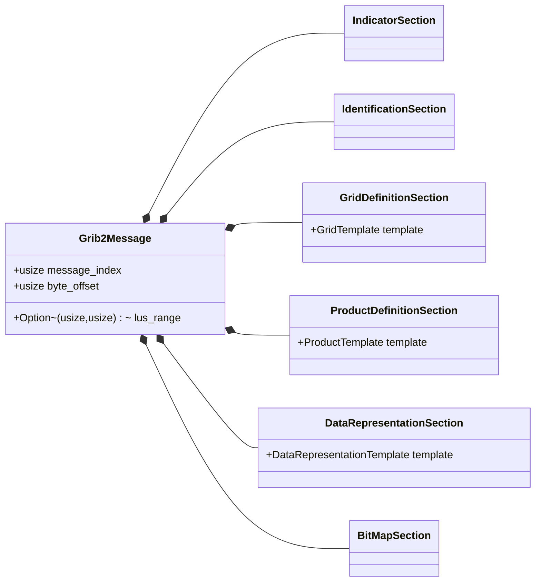
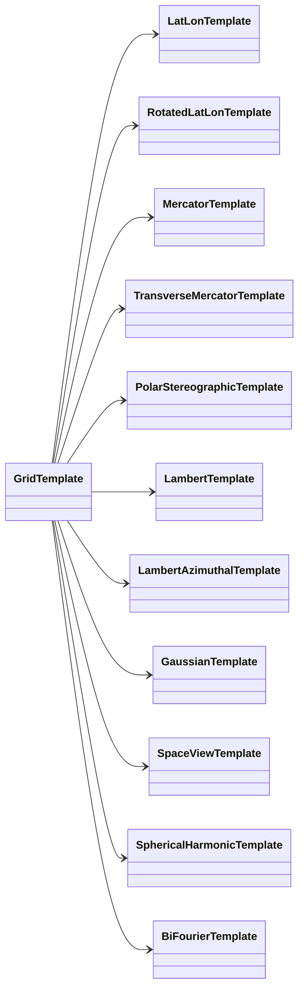
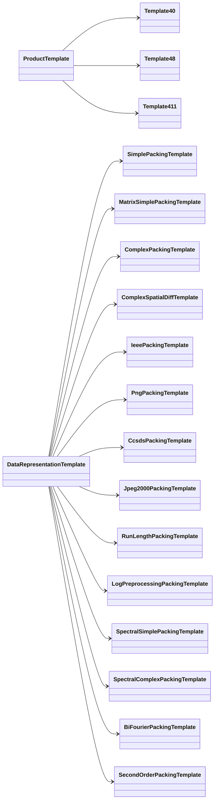
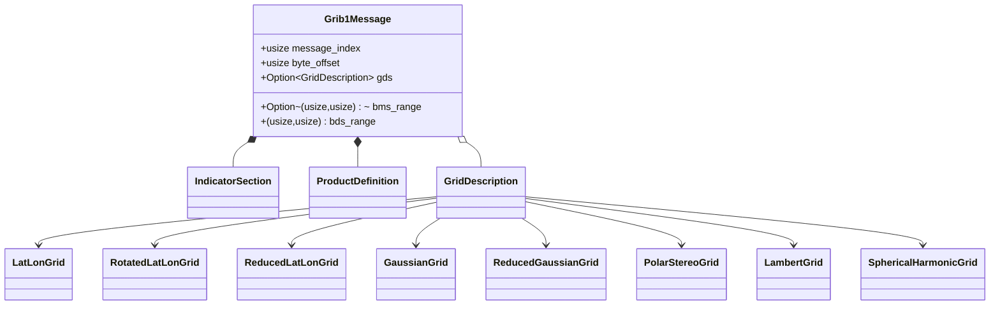
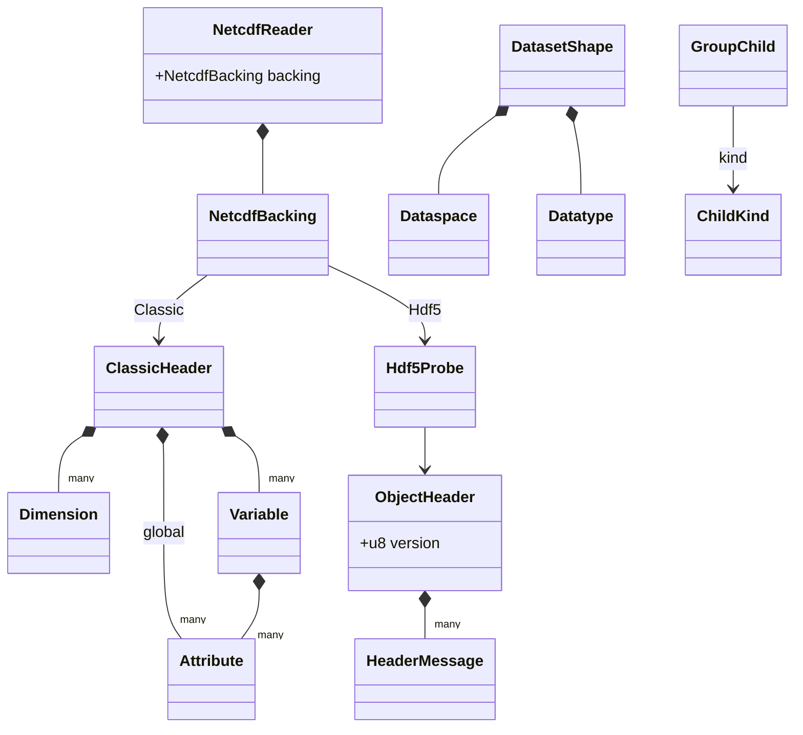
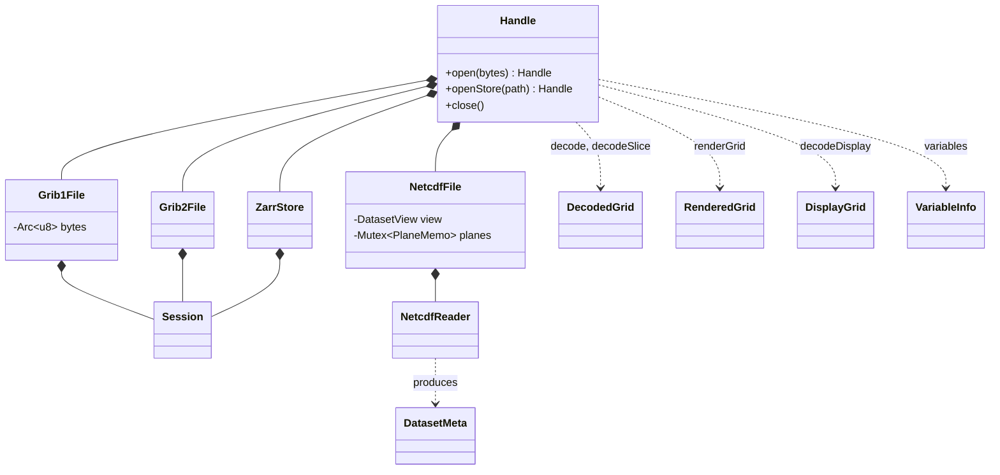

# Architecture — Level 3: composition (per format)

Each reader parses a file into one message that holds its sections. Where a
section's layout depends on a type code, the message carries a template enum and
the variant in hand is the one the code selected. Sections that are large or
optional stay as byte ranges and are decoded only when their values are asked
for, which keeps scanning a file cheap.

## GRIB2 message

One `Grib2Message` holds every WMO section. The grid, product, and
data-representation sections each carry a template enum.

Each enum resolves to one concrete template. `GridTemplate` to a projection:

`ProductTemplate` and `DataRepresentationTemplate` to a product and a packing
(the README "GRIB2 packing modes" table says which of these decode):

## GRIB1 message

Flatter than GRIB2: the grid description is optional, and the bitmap and data
sections stay as byte ranges that `Grib1Reader` decodes on request.

## NetCDF reader

One reader over two on-disk layouts. Classic CDF is parsed fully up front. HDF5
(NetCDF-4) is parsed by a deep walk of the object model (`ObjectHeader` →
messages → dataset shape), resolving groups, datasets, dataspaces, datatypes,
the dimension-scale convention, and attributes — including dense attributes held
in a fractal heap indexed by a B-tree.

## N-API boundary

The addon exports one `Handle`, as the browser module does (#1073). `open(bytes)`
detects the format and `openStore(path)` opens a Zarr directory; either way the
handle holds one per-container file, and every method dispatches to it. A GRIB
file is a `fieldglass::Session` plus the value memo the extension's repaint loop
needs (ADR-0011); a NetCDF file keeps its own reader and dataset view, a plane
memo and the curvilinear index cache; a Zarr store is a `Session` alone. Each
also keeps a `fieldglass::WarpMemo`, the last warp's pixel-to-cell map, so a
repaint that changes only the colours, or the field on the same grid, does not
warp again (#1233), and a probe reads the cell from it (#1313). A probe that
map does not serve keeps the target it was answered on, so the next probe
under the same options does not build it again (#1370). Which
messages carry no raster of their own and have to be put on one first
(spectral coefficients, HEALPix pixels) is the `Session`'s answer, not the
handle's.

The map pipeline (`renderGrid`, `probePixel`, `projectContours`, …) takes a
target — a message index, a slice of a variable, or two of either combined — so
one set of calls draws every container.

> Note: `IndicatorSection` appears in both the GRIB1 and GRIB2 sections above
> but they are **distinct types**, one per crate (`fieldglass-grib1` and
> `fieldglass-grib2`). The drift guard matches by base name and emits a warning
> about this so it isn't mistaken for a single shared type.
