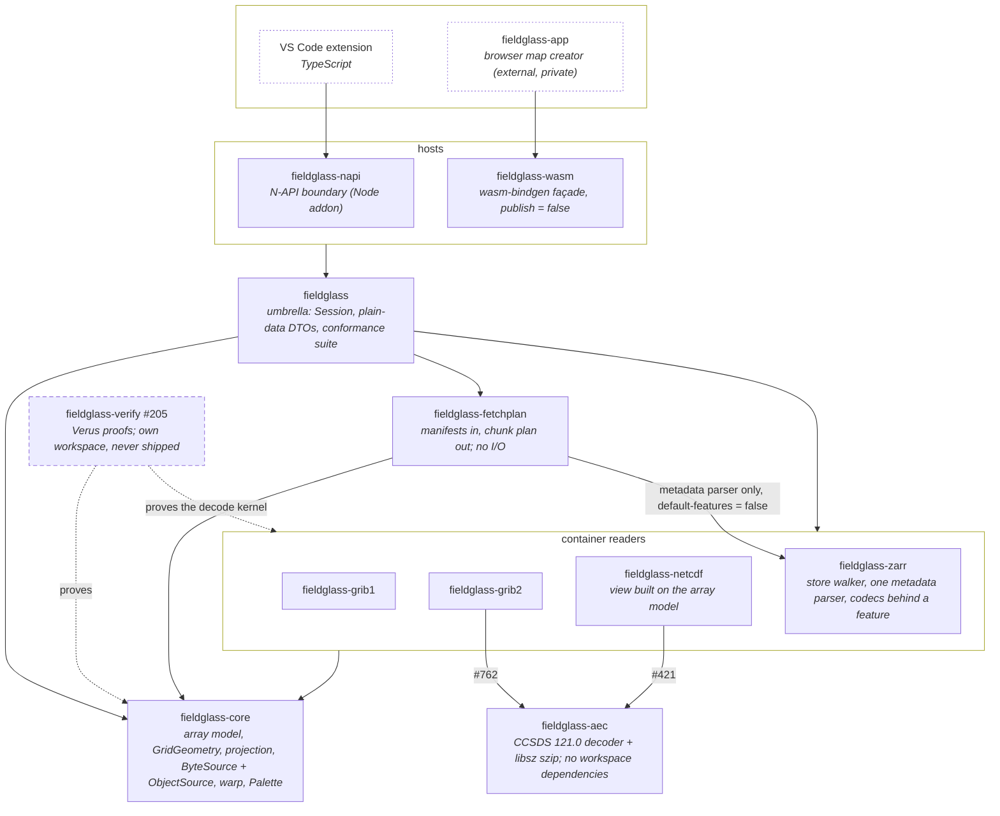

# Planned, level 1: crates

This is the workspace after milestones 7, 11, 12 and 13. Compare it with
[`../01-crates.md`](../01-crates.md).

The workspace is described as layers rather than as a list of crates
([ADR-0010](../../decisions/0010-a-common-array-model-and-containers-as-drivers.md)).
At the bottom is a model that every container reads into. Above it are the
container readers that do that reading, a storage seam that says where bytes
and objects come from, the manifest parsers that say which bytes to ask for,
and the hosts that bind one umbrella crate. The two rules from today's diagram
still hold: no format crate depends on another, and nothing below a host
depends on a host. A third rule is now written down: a shared layer adds no
dependency to a format crate, so a program that uses only `fieldglass-grib2`
links a GRIB2 reader and nothing else (ADR-0010 decision 6).

An edge into or out of a box applies to every crate in it. `fieldglass` depends
on all four container readers, on `core` and on `fetchplan`. Each reader
depends on `core` and on no other reader. Each host depends only on
`fieldglass`. The `fetchplan` → `zarr` edge exists for the metadata parser
(#686) and takes the crate with its codecs turned off, which is the same
arrangement as `fieldglass` → `core`. Only `fieldglass-verify` (#205) is still
planned.

`fieldglass-aec` is a codec crate, not a reader. It sits below the format
crates, beside `core`, and depends on neither
([ADR-0012](../../decisions/0012-own-the-aec-decoder.md)). Only the two readers
whose containers use the coder take it: `grib2` for template 5.42 and `netcdf`
for the HDF5 szip filter. So a GRIB1 or Zarr consumer never links it, and no
reader depends on another to reach it. For `grib2` it replaced an external
decoder (#762), so what a GRIB2-only consumer links didn't grow.

### What each layer is, and what changes in it

| Layer | Crate | Issue | What changes |
| --- | --- | --- | --- |
| Model | `fieldglass-core` | #677 | `array::ChunkGrid` and `ChunkKeyEncoding` moved here from `fetchplan`, on the ungated parsing surface, with no new dependency. Shipped. |
| Model | `fieldglass-core` | #678 | Dimension, attribute, array description and group types, with the CF unpacking rule stated once. Shipped. |
| Storage seam | `fieldglass-core` | #680, #681 | `ObjectSource` (get by key, list by prefix, prefetch) beside `ByteSource`, and `ByteSource` gains `identity()`. Both shipped. |
| Container reader | `fieldglass-zarr` | #686, #658 | One parser of `.zarray` and `zarr.json` that produces the model plus the codec chain; codecs behind a default-on `codecs` feature; and the store walker over `ObjectSource`, presenting `ArraySource` (#658). `Session` reaches it through one `Reader::Arrays` arm since #704. All shipped. |
| Container reader | `fieldglass-netcdf` | #684, #682 | `DatasetView` built on the model, and the HDF5 reader reading through `ByteSource` the way classic does. Both shipped. |
| Codec | `fieldglass-aec` | #758, #759, #761, #762, #421 | New. It sits below the format crates, beside `core`, and depends on neither. It's a CCSDS 121.0 decoder, correct per the standard and checked against libaec 1.1.7, with libsz's szip behavior in `fieldglass_aec::sz`. `grib2` decodes 5.42 with it (#762), and `netcdf` gains it for szip and keeps the HDF5 framing (#421). Shipped. |
| Manifests | `fieldglass-fetchplan` | #685, #687 | A `PlanItem` says which chunk or message it is. `Manifest` loses `key()`, the GRIB query moves to `MessageManifest`, and `KerchunkRefs` implements `Manifest`. The umbrella re-exports the kerchunk and chunk-grid surface. Shipped. |
| Umbrella | `fieldglass` | #679 | The Variables addressing mode is under conformance. Shipped. |
| Hosts | `fieldglass-napi` | #659 | Opens a Zarr store by filling an `ObjectSource` from a directory and handing it to the walker. Shipped. |
| Proofs | `fieldglass-verify` | #205 | Deliberately outside the workspace, so `cargo build`, `cargo deny` and the six-target cross-compile never see Verus. The crate exists (#197), and the proofs (#199–#204) have landed. Only the #205 epic is still open. |

### Features don't stop at a crate boundary

An optional part of `core` is off for a host that can't use it only if every
crate between the host and `core` says so. That's why `fieldglass` takes `core`
with `default-features = false` and passes `render` and `analysis` on as its
own features (#552), and why `fetchplan` takes `fieldglass-zarr` the same way
(#686). The array model, like `GridGeometry`, isn't behind a feature. It sits
in an always-on module, because the readers that take a cut-down `core` are the
ones that produce it. Nothing passes `fs` on. ADR-0005 hands every host bytes
rather than a path, so a CLI (#254) or PyO3 program that starts from a path
names `fieldglass-core` itself.

### What doesn't appear

HTTP range (#247) and S3 (#252) still aren't crates. Under ADR-0005 the host
does the fetching, and after #680 it fetches into an `ObjectSource` for a store
or a `ByteSource` for a file. #114 (files of several gigabytes) is the same
seam applied to a local file. A `fieldglass-array` crate doesn't appear
either: the model stays a module in `core` until something wants it without
the geometry (ADR-0010 decision 1).
