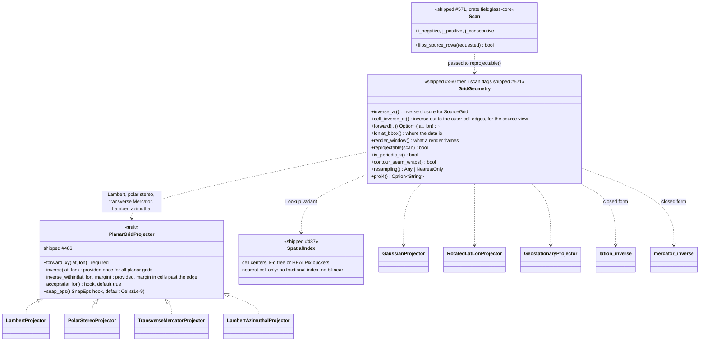
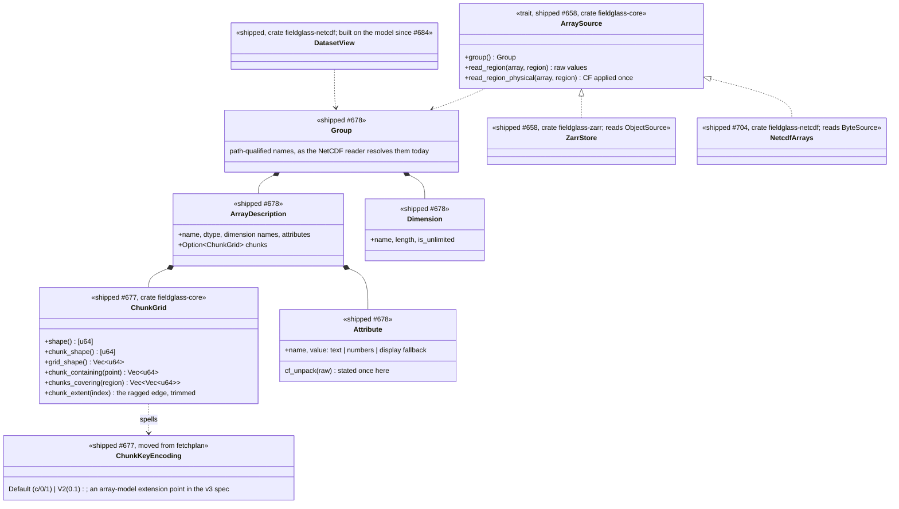
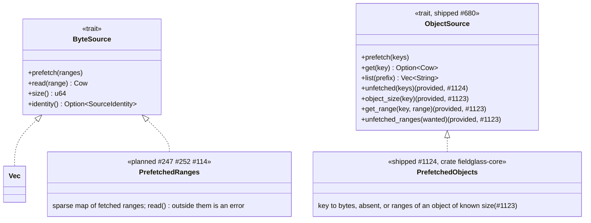
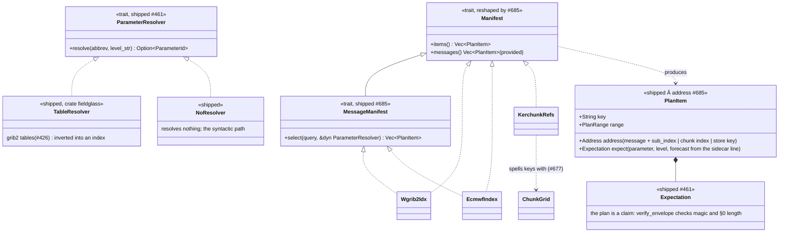
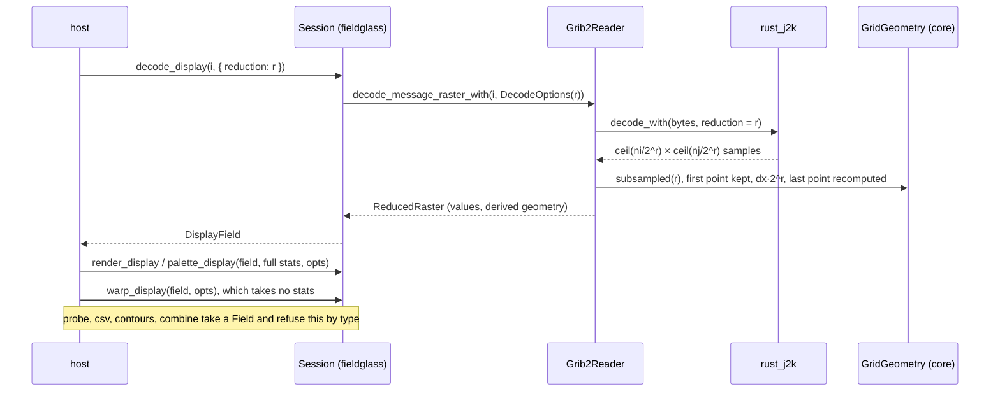
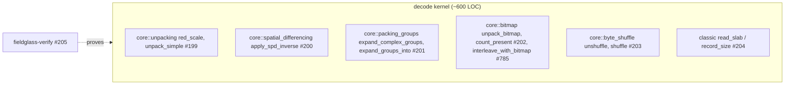

# Planned, level 2: trait seams

This is the dispatch picture after milestones 7, 10, 11 and 12. Compare it with
[`../02-trait-seams.md`](../02-trait-seams.md). Only the seams that change are
drawn. `Grib1Packing` and the `TargetProjection` / `PreparedTarget` /
`ForwardMap` family are unchanged, and stay in the checked diagram.

## Grid geometry becomes a type, and the inverse stays a closure

The nine per-family warp setups used to live in `napi` and take a flat
65-field `MessageMeta`. #460 created `GridGeometry` and #464 moved napi onto
it, so `core` owns `GridGeometry`, with one variant per family, built straight
from the typed GDS. The seam `warp` uses doesn't change. `SourceGrid::inverse_at`
is already a closure, so `GridGeometry::inverse_at()` is a `match` on the
variant that returns that closure, not a new trait. Behind it are two kinds of
inverse. One is a formula: the projectors, and closed-form functions for
latitude and longitude and for Mercator. The other is a lookup
(`SpatialIndex`, #437), for grids that are only a list of cell centers.

This fixes two things along the way. First, the four planar `inverse()` bodies
were the same 30 to 50 lines each: guards, forward, `(x − origin) / spacing`,
and an edge snap. The forward direction was already a provided method on
`PlanarGridProjector`, and the inverse joined it in #486, so the edge-snap rule
exists once. What really differed went into two hooks rather than four
near-copies. `accepts` is for a point the projection can't place at all.
`snap_eps` is for the edge tolerance: `SnapEps::Cells` for a round trip that
closes to float noise, and `SnapEps::Metres` for Lambert azimuthal, whose
authalic series carries a real millimeter-scale error, so its tolerance is a
property of the ground rather than of the cell.

Second, `GridIndex` is fractional because the raster grids are. A lookup grid
returns the nearest cell center, where the fractional part and the "next
column" neighbor mean nothing. So `GridGeometry::Lookup` reports `NearestOnly`,
and `warp` refuses bilinear against it, or falls back from it, rather than
blending across a tripolar fold.

The test for any inverse, formula or lookup, is that a grid places its own
points. Walk every `(i, j)`, find where it sits, invert that, and get `(i, j)`
back. It needs no outside oracle, because the grid's own forward map is the
answer, and it's what `.eccodes.ref.json` can't give, since that pins only the
forward direction. `crates/fieldglass-core/tests/grid_round_trip.rs` runs it
across all nine families, and a new family belongs there the day it's written.

The check existed before that file and still missed two bugs, which is the
part worth remembering. `assert_round_trips` in `projection.rs` had the right
shape at eight call sites, but each built a small synthetic grid, and the polar
stereographic one started at 27°N. It couldn't have found #488, where a north
polar grid refused everything south of the equator, because no grid it tested
went there. What a test covers is decided by its fixture. A lookup grid's
version of the same trap is a tripolar fold or a swath edge the test grid
happens not to contain, so the fixtures #444 added for #445 are a tripolar grid
and a swath, the awkward cases rather than the convenient ones.

These are the users of the lookup, in the order they were filed:

| Consumer | Issue | Where the cell centers come from |
| --- | --- | --- |
| NetCDF 2-D coordinate (curvilinear) grids | #445 | CF `coordinates`, pointing at two 2-D latitude and longitude variables |
| HEALPix §3.150 | #442, #443 | `pix2ang` in core, turned into a latitude and longitude grid at decode, like spectral |
| GRIB2 §3.204 NCEP curvilinear | #418 | Latitude and longitude carried as two extra fields |
| ICON §3.101 unstructured | #420, #419 | A grid file outside the data file, with its ADR pending |

## The array model

#677 and #678 added the layer above the grid model in `fieldglass-core` that
every container holding named arrays reads into
([ADR-0010](../../decisions/0010-a-common-array-model-and-containers-as-drivers.md)
decision 1). It's a regular chunk grid, with the encoding that spells a
chunk's key, plus the dimension, attribute, array-description and group types
that the NetCDF view (#684) and the Zarr walker (#658) both produce. It's Zarr
v3's array model, written from the specification and named in Fieldglass's
terms, because that's the model the cloud tools already map every other
container onto (decision 2). None of the model is a trait. The readers build
it and `Session` reads it, the way the readers build `GridGeometry` and `warp`
uses it.

What a reader presents is a trait (#658, ADR-0010's amendment to decision 3).
`ArraySource` is the array-level input seam, one step above `ByteSource` and
`ObjectSource`: the `Group` tree and a raw region read, with CF applied once
above it from the array's attributes. `ZarrStore` implements it over an
`ObjectSource`, and `NetcdfArrays` over a `ByteSource` (#704). #704 also moved
CF placement into core (`core::cf`) and folded `Session`'s Variables arm into
one `Reader::Arrays`, which is where Zarr reaches `Session`.

## Byte access gains a keyed sibling

`ByteSource` exists (#438, with NetCDF classic moved onto it). The remote
transports aren't Rust implementers, because ADR-0005 puts fetching in the
host. What Rust gains is a source over ranges the host already fetched, and,
with #680, a source over objects the host already fetched, which is what a
Zarr store, a directory listing and a kerchunk document all are.
`ObjectSource` follows the same rules: a read works whether or not it was
prefetched, and everything is synchronous. The napi host may implement it over
`std::fs`, because napi is the host, and a bucket is the browser filling the
in-memory one.

#681 added the identity ADR-0005 decision 2 asked for, so the HDF5 memo no
longer keys on length. #682 moved the HDF5 reader onto `ByteSource` the way
classic already was, and #697 moved both GRIB readers. All of it has shipped,
and what those moves settled about windowing and short reads is recorded in
the current [`02-trait-seams.md`](../02-trait-seams.md).

`PrefetchedObjects` also holds part of an object (#1123): ranges a host
fetched, together with the object's whole size. That's how a browser reads a
Zarr shard's index and a few of its inner chunks instead of the whole shard. A
key held that way answers `get_range` inside a range it was given, names the
rest through `unfetched_ranges`, and counts as unfetched as a whole object.
It's the keyed form of `PrefetchedRanges`, so when that source lands for one
file, it should share the range lookup and the refusals (a range past the
size, or two sizes for one source) rather than grow a second set.

## Fetch planning: manifests in, chunk plan out

`fieldglass-fetchplan` reads a manifest and says where each chunk or message
is. Every cloud-native convention is one dialect of it. The crate is syntax
only. Matching a sidecar's `TMP` and `2 m above ground` to a WMO parameter
needs the NCEP table in `fieldglass-grib2` (#426), and that dependency would
drag the decoder and its codecs into a pure planner, so semantic matching is a
trait the umbrella implements.

The GRIB half landed with #461, the kerchunk half with #660, and the reshape
with #685 (ADR-0010 decision 4). The current
[`02-trait-seams.md`](../02-trait-seams.md) documents all three. The
`Manifest` that shipped first promised one object key per manifest and a
parameter query, and both promises were GRIB's. A reference document addresses
many objects and has nothing to query, which is why `KerchunkRefs` couldn't
implement it.

Now a `PlanItem` carries its own address: a message index with an optional
sub-index, a chunk index, or a store key that names no chunk. `Manifest` keeps
`items()` and the provided `messages()`, the query is on a `MessageManifest`
extension trait, and all three dialects share the base trait. The chunk-grid
arithmetic the kerchunk half leans on is `core`'s (#677). Kerchunk itself stays
here, because a reference document is a manifest.

Four things about the GRIB half are facts rather than plans:

* A plan range is `PlanRange` (`Exact`, `OpenEnded` or `Whole`, because a
  `.idx` states no length), and `PlanRange::close(object_size)` returns
  `core`'s `ByteRange`, the type `ByteSource::prefetch` takes, rather than a
  range type of the crate's own. The alternative was two spellings of one
  concept, and the diagram check flagged the name clash before it shipped.
* `Manifest::messages` is a provided method, not one per dialect. Collapsing a
  message's fields onto one fetch is a property of the plan, not of the grammar
  it was read from. `messages()` drops a message's sibling fields, recognizing
  them by their address rather than by their range, so two chunks at the same
  bytes stay two.
* `NoResolver` is part of the surface. Without an implementer that resolves
  nothing, the syntactic path (matching the sidecar's own words, which is what
  a user pasting a `.idx` line has) couldn't be exercised without the
  umbrella, and the crate couldn't be tested alone.
* Ambiguity needs two settings, not one. `Query::qualifiers` can only add
  requirements, and NBM publishes a plain deterministic field beside its
  probabilistic ones under the same abbreviation and level.
  `Query::unqualified` is how that record is named. Without it, it would be the
  one member of an ambiguous set that nothing could ask for.

## Decode options

#463 adds a `DecodeOptions { reduction }` to the GRIB2 decode path. It isn't a
trait. Only 5.40 honors it, the rest return `Unsupported` for a value other
than zero, and a message with a bitmap refuses it. It's drawn because a
reduced field carries a derived `GridGeometry`, never the message's own GDS.

The decode half has landed (`fieldglass-grib2`,
`Grib2Reader::decode_message_raster_with`), and three things about it are now
facts rather than plans:

* The derived geometry is `GridGeometry::subsampled(r)` in `core`, not a
  `From(gds, r)` in grib2, because it's a question about a grid, and both
  editions will want it. It declines a Gaussian grid, because every other
  Gauss–Legendre node isn't the half-order quadrature, and there's no
  `GaussianParams` that describes the rows kept.
* There are five refusals, not two: any packing but 5.40, a §6 bitmap, a
  reduced grid, alternate-row or `j`-consecutive scanning, and a family with no
  coarse geometry to derive. The two scanning orders are the ones the plan
  missed. Both are undone after the packing decodes, and a wavelet low-pass of
  a scrambled raster can't be undone.
* The "render and warp only" rule is carried by `ReducedRaster`, whose
  `exact_values()` answers `Some` only at reduction zero. It's an `Option`, not
  a new error variant, following #633's precedent: when a caller learns "these
  aren't the message's numbers", the response is to ask again at reduction
  zero, not to branch on a code.

The host half is built (#1082), as parallel methods. The owner chose them over
a sealed trait bound on 2026-10-16. The bound would still need two methods in
every binding, since neither wasm-bindgen nor napi crosses a generic, and it
would put a generic on the host surface, which ADR-0006 decision 2 rules out.
A single field type with a reduction flag was rejected too, because misuse
would fail only when it ran.

* `Session::decode_display(i, &DisplayDecodeOptions { reduction, dtype })`
  returns a `DisplayField`: values, mask, shape, a `Georef` built on
  `GridGeometry::subsampled(r)`, and the `reduction`. It has its own options
  type, not a field on `DecodeOptions`, because the two decodes return
  different types. At reduction zero it's `decode`'s field for every message,
  so a host that picks the level from the zoom has one code path.
* `render_display`, `warp_display` and `palette_display` take a
  `DisplayField`, while `probe`, `contours`, `combine` and CSV take only a
  `Field`. Handing them a display field is a compile error in Rust
  (`compile_fail` doctests on `Session::decode_display`) and a type error in
  the browser module's TypeScript: `DisplayFieldHandle` lacks `stats()` and has
  `reduction()`, so neither class can be assigned to the other, and
  `package.mjs` type-checks the misuse. The drawing half shares one
  implementation through a private borrowed view of either type.
* The color range is the full field's, from `Stats` the caller supplies
  (`full: Option<&Stats>`), never the display field's own. A wavelet low-pass
  trims some extremes and overshoots others (the RAP fixture's maximum by
  0.69 K at reduction 1), so its own range would differ between viewers at
  different reductions. This is #880's rule 6, applied through
  `fieldglass::full_field_extremes`, which both hosts call. `None` is allowed
  only when both ends are set by hand.
* A refusal above reduction zero is `Error::Unsupported`, so a host falls back
  to reduction zero. The reader's refusals are `UnsupportedSection`, which the
  general error mapping turns into `decode`, so `decode_display` maps them
  itself.
* The browser module binds `decodeDisplay`, `renderDisplay`, `warpDisplay` and
  `paletteDisplay` on its `Handle`. The Node addon binds `decodeDisplay`, which
  returns a `DisplayGrid` class, and `renderDisplayGrid` on its `Handle`
  (#1073). That pipeline is both the render and the warp, so a reprojection
  target warps the coarse grid from its own geometry. Neither host caches the
  display field, because it belongs to the caller.
* The conformance suite has the four as operations (`decodeDisplay`,
  `renderDisplay`, `warpDisplay` and `paletteDisplay`) over the RAP fixture,
  with the full stats passed back, and the two refusals: a message with no
  pyramid (`unsupported`) and an automatic range with no stats
  (`invalid_option`). The browser runner replays all four. The addon's runner
  replays the decode and the render, and skips the other two because the addon
  has no warp or palette call.

## Presentation is data, not a seam

`Palette` (#485, the painter's lookup table and scale rule, pulled out as an
API type) is deliberately not a trait. There's one painter, and a GPU host
uses the painter's table rather than implementing a second color path. See
[`03-composition.md`](03-composition.md).

## Verification (milestone 7)

This isn't a run-time seam, but it's a boundary worth drawing: which functions
carry a Verus proof. `fieldglass-verify`, outside the workspace, includes each
kernel file of the shipped crates by `#[path]` and proves it in place. The
specs sit in `cfg_attr(verus_keep_ghost, ...)` attributes, which a normal build
never expands (#199, [`../../verification.md`](../../verification.md)). The
GRIB scaling kernel, the inverse spatial differencing (#200), the group
expansion (#201) and the presence bitmaps (#202), all shared by the two
editions, are proved, and so are the byte shuffle the HDF5 and Zarr readers
share and NetCDF classic's length and offset arithmetic (#204).

