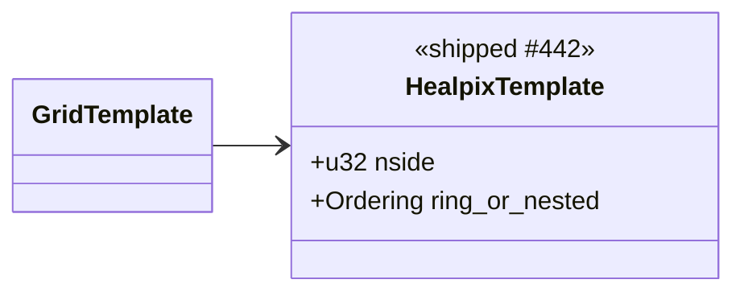
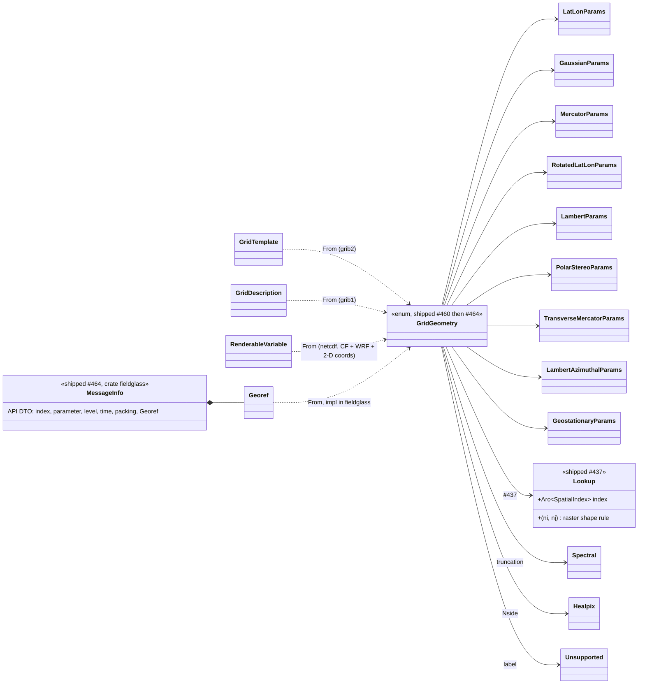
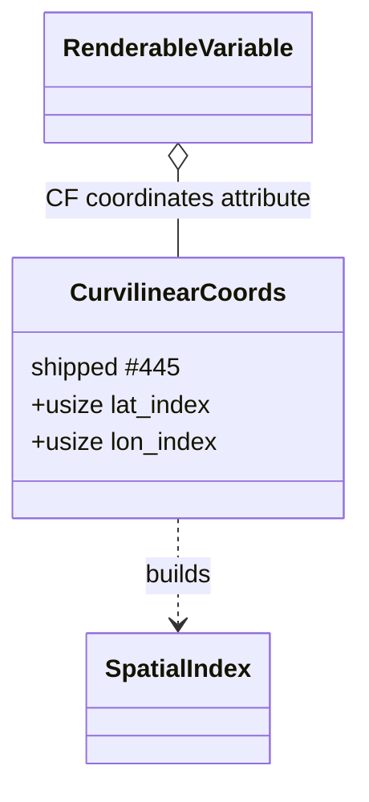
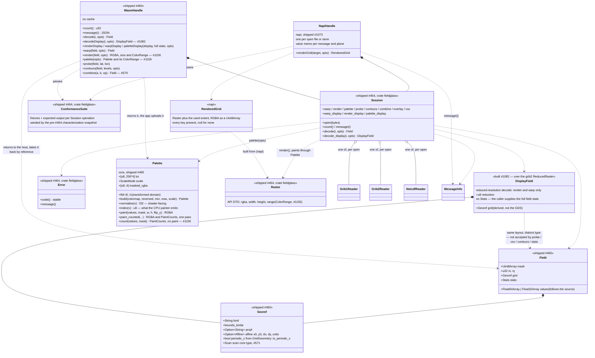

# Planned, level 3: composition

This is how messages are put together after milestones 10, 11 and 12. Compare
it with [`../03-composition.md`](../03-composition.md). GRIB1 and the NetCDF
reader are unchanged except where drawn.

## GRIB2 grid templates gain HEALPix

`GridTemplate` gets one variant (#442). Everything else in the GRIB2 message
stays as it is today.

## Core owns the geometry, and `MessageMeta` becomes a view

This is the center of #464. Every format's typed grid description converts
into one `GridGeometry`. The `fieldglass` umbrella builds one API view of it,
`Georef`, inside `MessageInfo`. Hosts derive their own types from the API DTOs,
never from core, and nothing in Rust reads a DTO back. Dependencies point only
down: core knows no DTO, and `fieldglass` knows no host.

The synthesized grids (spectral and HEALPix, both shipped) keep their pattern.
The decode seam resamples them onto a regular latitude and longitude grid, and
the field carries a `GridGeometry::LatLon` for that grid, so probe, contours,
CSV and overlays need no special case. `Session::decode` has done this since
#580, through the format readers' `synthesis_grid` and
`synthesize_message_global`, so which families need it, and what grid each
lands on, is stated once rather than per host.

That grid is the one thing downstream code may align on.
`spectral_render_dims` ignores the truncation, so two spectral fields at
different truncations land on the same raster and really do combine, while two
HEALPix fields at different `Nside` don't. But it isn't the size the file
states, and a message view that reported only the synthesized raster would be
describing Fieldglass rather than the data. So the native size should survive
beside it, in two planned variants: a `Healpix` carrying `Nside`, and a
`Spectral` carrying its truncation. `GridDefinition::size_label` reads those
numbers today. Deriving `Georef` from the variants is untracked.

The grid also limits what a spectral field can show. 720 × 361 carries
wavenumbers up to T359 (`core::sht::spectral_render_band_limit`, derived from
`spectral_render_dims`), so a field that declares more is synthesized
band-limited to that (#637). That's the correct picture at this resolution,
but it's a different field from the file's, so it's never silent.
`Field::truncation` and `MessageInfo::truncation` carry
`{ declared, truncatedTo }` to every host, and the one special case left
downstream is the probe, which reports two values. `Session::probe_message`
answers the value the map shows at the cell `probe` would read, and beside it
`full_detail`: the full sum at that cell's node (`Session::probe_full_detail`),
labeled with the truncation it carries. Whole-grid exports follow the map and
carry the label.

Neither variant exists yet, and #580 didn't need them. It moved only where the
decoded field sits. The native size still travels as `MessageInfo::size_label`
(`T63`, `Nside 4`), with the declared grid arriving as
`Unsupported { label }`. So the variants are still owed, by a `Georef`
derivation that reads them instead of a label string. That work has been
untracked since #464 closed. The decode seam, which is done, doesn't owe them.

Reduced Gaussian is the same question with the answer the other way round, and
it constrains the conversion rather than the view. `GaussianParams::ni` is a
plain `u32`, so the variant as drawn can hold only a regular grid, while the
rows of a reduced one differ in width. Converting one means choosing what `ni`
means, and both readers now answer the same way: the widest row, because that's
the raster they expand into (#503).

The eastern corner that travels with it is derived from that width rather than
read from the message. An octahedral grid declares `lo2` from the narrower `4N`
reference grid, so the file's own value doesn't describe the raster. That
derivation lives in the format crates
(`GridDescription::raster_bounds` and `GridDefinitionSection::raster_bounds`,
beside `dimensions()`, and `decode_message_raster` for the values that go in
it), so `GridGeometry::from` and the napi render seam both read it rather than
each deriving it again (#543). A `GridGeometry::Gaussian` built from `lo2` at
face value would misplace every octahedral grid by up to an eighth of a cell.
The grid's own name (`N32`, `O32`, and `F32` for the regular case ecCodes also
names) can't be recovered from `ni` and `nj`, so it travels beside them the way
`Nside` does (#500).

The family tag is the other thing the conversion loses. Both readers report
`reduced_gaussian`, which is what ecCodes calls `reduced_gg` and what the
message table shows, while `GridGeometry::kind` answers `"gaussian"` for the
variant that holds it. So for a while the two hosts disagreed in public. The
extension's grid-type column said `reduced_gaussian`, and the umbrella, and so
the browser host, said `gaussian` (#503, #645).

#645 settled it: the format crate owns the name and both hosts read it, the way
#543 settled the octahedral half of the same handoff. `GridGeometry` is
unchanged. Its variants describe how points are placed, and after the row
expansion a reduced grid's points are placed exactly as its regular sibling's
are, so `kind`, which is the serde tag and must stay the variant's own name,
stays `"gaussian"`. The declared family isn't geometry but message metadata,
so it travels as `Georef::label`, set by `Georef::from_declared` from
`GridDescription::grid_type_name` or `GridDefinitionSection::template_name`
rather than worked out again from the collapsed geometry. A `reduced_gg`
message is now `kind` `gaussian` and `label` `reduced_gaussian` in both hosts,
and the conformance suite carries a reduced-Gaussian subject, which pins the
pair for the runners that drive `Op::Message`.

That pin is weaker than it looks. Both hosts serialize `Georef` as it is, so
they can't differ from the umbrella by construction, and a runner comparing
`Op::Message` can't fail: it tests the umbrella, not the hosts. Since #574
that includes `fieldglass-napi`, whose handles' `message(i)` returns
`MessageInfo` itself and whose conformance runner compares `Op::Message`
through it. `declared_grid_family_tests`, which compared the addon's own
mapping with the umbrella's, went when #726 removed that mapping.

Three alternatives were rejected, each for a reason worth keeping:

* Widening the variant. A `ReducedGaussian` arm would carry the same
  `GaussianParams` and behave identically in every projection path, so it
  would be a duplicate arm at the 32 places the workspace names
  `GridGeometry::Gaussian`, with nothing to tell it apart. And the doc comment
  on GRIB1's `GridDescription::scanning_mode` already records what happens
  next ("every consumer that has done so has ended up with an arm list that
  quietly omits a grid family").
* A reduced flag beside `ni`. `LatLonParams` is built at 74 sites (the global
  grid, the warp, the overlay, NetCDF, the synthesized rasters) where "reduced"
  means nothing and the flag would be `false`. It would add `"reduced": false`
  to the serialized form of every latitude and longitude and Gaussian grid.
  And since `kind` must equal the serde tag, the flag alone still wouldn't make
  the hosts agree.
* Letting the grid-type column stop telling them apart. That reverses #503, a
  shipped decision recorded in the CHANGELOG, which named the two apart because
  they aren't the same grid, and it loses information from a column a user
  reads.

`label` was already the more specific of the two for a family this build
doesn't place points on (`spherical_harmonic`, `healpix`, `unsupported(3.99)`,
all of `kind` `unsupported`), so the reduced pair joins an existing split
rather than opening a new one. The same change deleted a second copy of the
family-name list in `fieldglass-grib2/src/geometry.rs`, which had drifted from
`template_name` and dropped the template number from an unmodeled family's
label.

## NetCDF: curvilinear grids

This shipped in #445. It's the third way of placing a grid, alongside
ADR-0004's two. The reader resolves the CF `coordinates` attribute to two
auxiliary coordinate variables and hands them to the spatial index, and the
render pipeline still sees `Vec<Option<f64>>` plus a geometry.

`CurvilinearCoords` carries decode indices, not the arrays. A `DatasetView` is
metadata, and only the render seam wants the planes, once per slice. The index
itself is cached on the handle by the coordinate pair rather than by the
field, because one file's fields share one mesh.

The conversion has to keep two things. A `coordinates` attribute may name more
than the pair (RTOFS writes `"Longitude Latitude Date"`), so names are
resolved and kept only if they're 2-D over exactly the dimensions being drawn.
And a 2-D coordinate may legitimately be masked where a 1-D axis may not. A
swath granule marks the fields of view that saw no Earth, so a fill there is
data rather than damage, and the index keeps such a cell in place without ever
returning it.

## The two host boundaries after #464

Both hosts bind one `Session` in the `fieldglass` umbrella crate (ADR-0006).
Their DTOs are derived from its serde types, only the buffer handoff and the
error mapping are written by hand, and both run the crate's conformance suite.
The declarations are generated too (#574).
`crates/fieldglass/schema/api.schema.json` is held to the wire types by
`api_rules.rs`, and `tools/gen_api_declarations.py` turns it into
`extension/src/api.generated.ts` and the browser package's embedded
`api.generated.d.ts`. Both hosts send every key of a returned object, with
`null` for none, so the two files hold the same `T | null` declarations.

wasm returns the API `MessageInfo` as it is, and so does napi's `message(i)`
(through `serde_json::Value`), which is what the extension lists a file with.
The addon's own `MessageMeta` view is gone (#574). napi's other returned
objects, the ones that carry a buffer or answer a pixel rather than a point
(`RenderedGrid`, `ProbeResult`, …), stay its own and follow the same contract
through `use_nullable`. napi keeps its caches, because the extension changes a
picker and expects a free repaint. wasm keeps none: the host owns every field
it decoded and passes it back for render, probe and contours, so memory is the
app's decision.

Both hosts export one `Handle` with the same names and arguments for what they
share: opening, listing and decoding (#1073). The addon's map pipeline, which
the browser module doesn't have, takes a target (a message index, a slice, or
two combined) rather than a method per container. See
[`04-hosts.md`](04-hosts.md#one-javascript-api).

`RenderOptions` and `WarpOptions` carry a `width` × `height` the caller
controls, for the box targets (#465, landed). Without it, `warp` stays at the
source `ni × nj`, and the render targets keep the sizing they derive: that
shape raised to at least a 720-pixel long edge (#514), or the window's shape
for a coordinate-lookup grid (#515). The azimuthal and world targets keep the
aspect their projection fixes and ignore the pair, and so does `"source"`. The
extension doesn't set it yet. Exporting a figure at a chosen size, the consumer
half, has been untracked since #403 closed without it. It also has to
re-project the overlays and re-trace the contours at the export size rather
than scale up a bitmap.

Color exists once. `Palette` is what the CPU painter already builds inside (a
256-entry lookup table plus the scale rule), pulled out as an API type.
`render()` paints through it, and a GPU host uploads the same table and applies
the same two-line normalization in a shader snippet the package ships, so the
CPU output is the oracle for the GPU output.

The range a palette spans is chosen once too (#1155). `fieldglass::color_range`
takes the whole decoded field's present-cell extremes, before any warp, and the
caller's optional `min`, `max` and `center`, and returns a `ColorRange` or an
`invalid_option` carrying a `RangeRefusal`. `Session::palette` and `render`,
the addon's render path and both contour paths call it, and
`Palette::paint_counted` fills in the range's below, above and present counts
in the same pass that paints.

Both hosts report the range they used (#1156): the addon's
`RenderedGrid.range`, and the browser module's `render(...).range` and
`palette(...).range`. A palette paints nothing, so `Session::palette_range`
counts the field's cells with `Palette::count`, and its range equals the one
`render` reports for the same options. `Session::palette_with_range` returns
the palette and that range from one build (#1196), and that's what the browser
module's `palette` and `paletteDisplay` call. The ends and the range's source
match across hosts. The counts match only in the source projection, because
the addon counts the pixels of the raster it warped to, and `Session` counts
cells.
