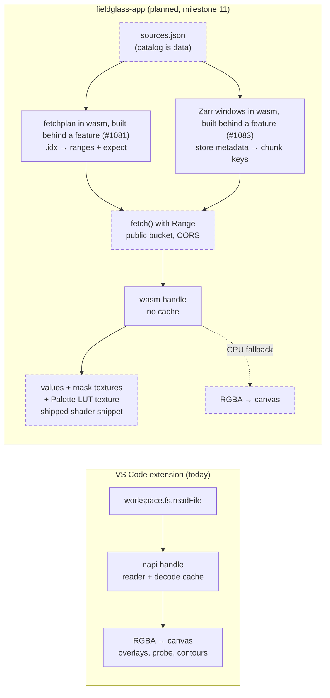
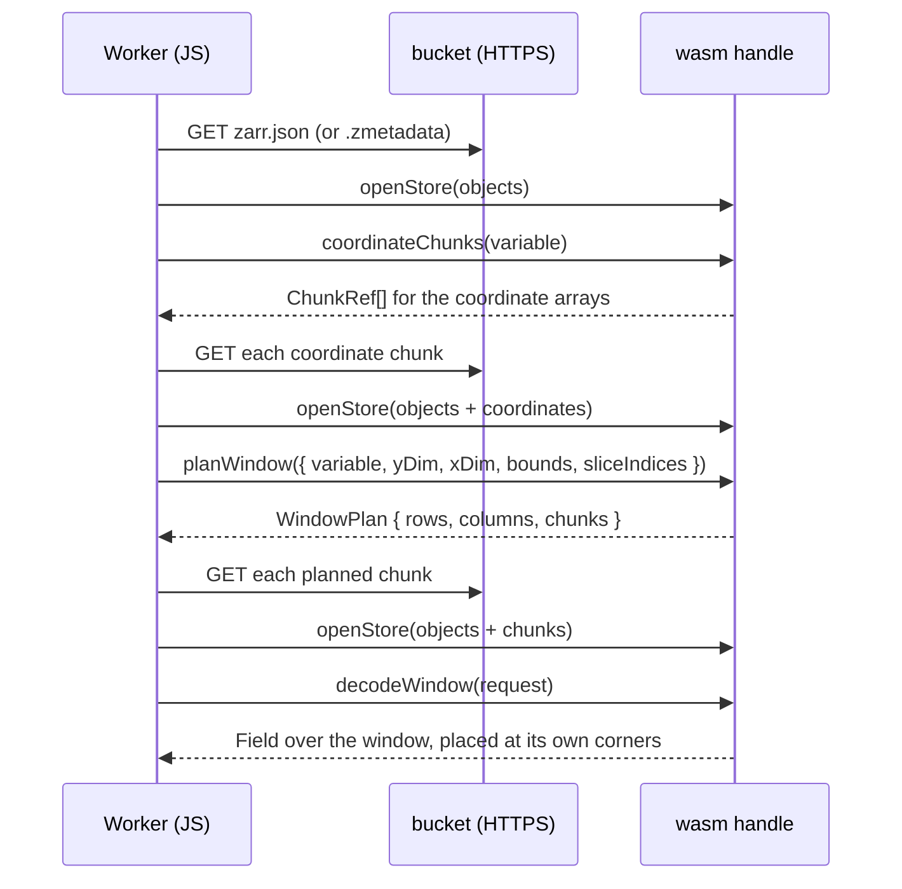
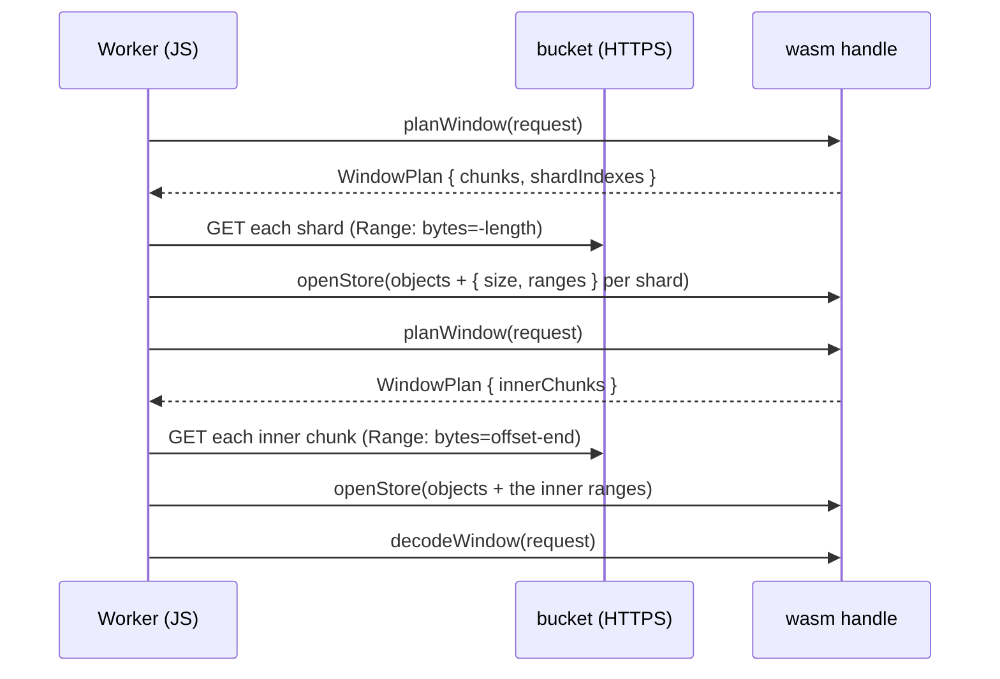
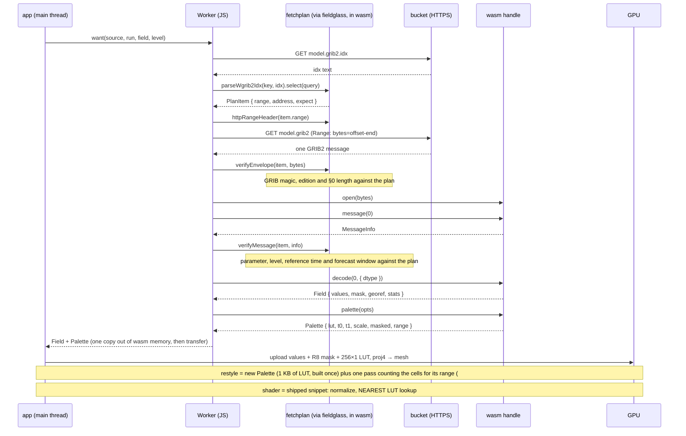

# Planned, level 4: hosts

This is a new level. The checked diagrams stop at the host crates. This one
shows what each host does around the Rust, which is where the interesting
design is.

## Who does what

ADR-0005 fixes the split: the host fetches and owns memory, and Rust is a pure
function of bytes. ADR-0006 fixes what a host is: a binding over
`fieldglass::Session` that writes by hand only the buffer handoff and the
error mapping. Both hosts follow both, but they differ in what they cache and
in how a file arrives.

## One JavaScript API

The two JavaScript hosts bind `Session` in one shape (#1073). Each exports a
`Handle` from `open(bytes)`, for a GRIB or NetCDF file, or from `openStore(…)`,
for a Zarr store (a directory in Node, the fetched objects in the browser). An
operation both hosts have is spelled the same way and takes the same arguments
in both: the camelCase of its `Session` name.

| | both hosts |
|---|---|
| open | `open(bytes)`, `openStore(…)`, `combineOps()` |
| ask first | `format()`, `addressing()` |
| list | `count()`, `message(index)`, `variables()`, `dimensions()`, `leftOut()`, `undrawable()` |
| ask about a pair | `vectorPairing(u, v)` |
| decode | `decode(index, { dtype })`, `decodeSlice({ variable, yDim, xDim, sliceIndices }, { dtype })`, `decodeLine({ variable, alongDim, sliceIndices }, { dtype })`, `decodeDisplay(index, { reduction, dtype })` |
| release | `close()`, which is also `[Symbol.dispose]`, so `using` works |

The return types are each host's own, because the bulk buffers are (ADR-0006
decision 1). Beyond the table, the browser module has the GPU path (`warp`,
`palette`, `shaderValues`, …) over fields the page holds. The addon has the
extension's map pipeline (`renderGrid`, `probePixel`, `projectContours`, …)
over a memo, addressed by a target: a message index, a slice, or
`{ a, b, op }`. No name means two operations. The browser's `probe` reads a
point of a field, so the addon's pixel read is `probePixel`. Arguments are
objects rather than positional runs, parameters are camelCase, bytes cross as
`Uint8Array`, and no Rust doc link reaches either `.d.ts`.
`tools/check_js_api.py` holds each host's generated declarations to this in
CI.

### Synchronous, with the async names reserved

The bytes-in path stays the main one (ADR-0005), and fieldglass-app uses it.
The async layer (#1085) lands beside it, and only adds, under names reserved
now:

* `load(source, { signal })`, beside `open(bytes)`: the fetch done by the
  library, resolving to the same `Handle`.
* `<name>Async(…the same arguments, { signal })` beside each long call
  (`decodeAsync`, `decodeSliceAsync`, `renderGridAsync`, `warpAsync`, …),
  resolving to what the synchronous call returns. In the addon these run as
  napi `AsyncTask`s, off the extension host's main thread.

`{ signal }` follows the WHATWG standard: an already-aborted signal rejects at
once, and an abort rejects with `signal.reason`. Neither host may declare a
reserved name before #1085, and the same checker fails if one does.

## One window of a Zarr store

A store is many objects, and the browser fetches only the ones a view needs.
The store says which, in three rounds, each synchronous and reading only the
objects already handed over (#1083):

A [sharded](https://zarr-specs.readthedocs.io/en/latest/v3/codecs/sharding-indexed/index.html) variable's `chunks` are shards, which can hold many steps or a large
area. So the plan also names each shard's index (`shardIndexes`, the shard's
last or first bytes). Once those are in the map, as `{ size, ranges }` under
the shard's key, planning again names the byte range of each inner chunk the
window touches (`innerChunks`). The Worker fetches those ranges and decodes
from them and the indexes alone (#1123).

A cell is in the box when its center is, and a box across the seam of a
global grid is two runs of columns read as one window. The plan's keys are
spelled by the same code the read fetches with (`ZarrStore::chunk_keys`), so
fetching exactly those is enough. A key the Worker passes as `null` (a 404)
reads as the fill value, the way an absent chunk does, and a key it doesn't
pass at all is refused by name (#1124). Windows are planned over slices placed
on a regular latitude and longitude grid, as 1-D latitude and longitude
coordinates place them, and any other placement is refused. It's built behind
`fieldglass-wasm`'s `zarr` feature, and ships in the package's
`@fieldglass/wasm/full` entry (#1158).

## One field, from a bucket to a texture

This is the sequence the browser runs for a single GRIB2 message. Every arrow
into Rust is synchronous, and every network wait is in the Worker's
JavaScript.

These notes shape the two hosts:

- Memory. WebAssembly's linear memory never shrinks, so the layer holds no
  decode cache. The app decides which `Field`s to keep for an animation and
  drops the rest. napi keeps its caches, because the extension's repaint loop
  depends on them.
- Failure. The wasm crate builds with `panic = "abort"`, so a decoder panic
  ends the Worker. The app treats the Worker as disposable and restarts it, and
  the fuzz targets keep that rare.
- Sizing. `warp` outputs the source `ni × nj` unless the caller names a `width`
  × `height`, which is what a map view needs (#465). The render options carry
  the same pair for the two latitude-and-longitude box targets. There, the
  default when it isn't named isn't `ni × nj`, but that shape raised to at
  least a 720-pixel long edge (#514), or the window's shape for a
  coordinate-lookup grid (#515). The size also reaches the overlay and contour
  projections and the pixel probe there, so a host that sets it for one must
  set it for all of them.
- Zoom. For JPEG 2000 ([5.40](https://www.nco.ncep.noaa.gov/pmb/docs/grib2/grib2_doc/grib2_temp5-40.shtml)) fields, #463 lets the app decode at a lower
  wavelet level when the view is coarser than the grid. The georef it returns
  is derived, not the message's GDS, and the field is for display only: probe,
  CSV, contours and stats always use the full-resolution decode. The decode
  itself exists (`Grib2Reader::decode_message_raster_with`: 39.9 ms, 10.5 ms
  and 2.8 ms on the committed 451×337 RAP fixture at reductions 0, 1 and 2),
  and both hosts reach it through `decodeDisplay` (#1082). The decision behind
  that shape is recorded under Decode options in
  [`02-trait-seams.md`](02-trait-seams.md).
- Precision. `Field.values` is f64 unless the packing provably fits f32. The
  R32F texture upload is a downcast the app asks for explicitly.
- Color. It's decided once, in Rust: `Palette` feeds both the CPU painter and
  the GPU lookup, and the app's `readPixels` is tested against `render()`. The
  tolerance is one lookup-table entry, not zero, because `Palette::normalise`
  narrows to `f32`, and that moves the index for about six positions in a
  million against `Palette::index`, the exact byte the painter writes.

  That bound holds only if the shader is handed a rebased domain. A shader
  that subtracts and divides raw `f32` values against raw `f32` bounds loses
  the domain, not just the last bit. Once the `f32` gap at `t0` passes one
  lookup step, about `t1 - t0 < 255 · |t0| · 2⁻²³`, the error has no bound
  within the ramp, measured at 127 entries for a manual range of 1.0 over
  values near `1e7`. Geopotential in m²/s², pressure in Pa and radiances all
  reach that regime under a tight manual range, so the app uploads `v − t0`
  and the cancellation stays in `f64`. That's why `t0` and `t1` are `f64`. Both
  the bound and the breakdown are pinned by
  `crates/fieldglass-core/tests/palette_golden.rs`.
- Trust. A `.idx` range is a claim. `verifyEnvelope` checks the fetched bytes
  against it (marker, edition, length) before they're opened, and throws
  `short_read` for a short transfer and `decode` for bytes that aren't the
  message, which is what a stale sidecar produces (#1081). It assumes a
  successful ranged response, so the Worker checks the HTTP status first. The
  planner calls are built behind `fieldglass-wasm`'s `fetchplan` feature and
  ship in the package's second entry, `@fieldglass/wasm/full`, beside Zarr,
  and the default entry leaves both out (#1158).

  `verifyMessage` then checks the opened message's parameter, level, reference
  time and forecast window against the sidecar line, comparing values rather
  than wording (`2 mb` is a message coded at 200 Pa), and throws `decode` for a
  valid message that's another field (#1093). An ECMWF line's MARS name must be
  one that ecCodes (2.34.1, 2.45.0 or 2.48.0) would give the message, judged on
  the codes, surfaces, statistics and probability alone, with the most specific
  match winning, so `mx2t3` isn't `mn2t3` and `100u` isn't `10u` (#1116,
  #1298). The checker can't tell some names from others that ecCodes gives the
  same message: wave-period heights from `swh`, the AIFS probabilities `tpl01`,
  `2tl273` and `10spg10` from `tp`, `2t` and `10si`, and, from tables version
  34 in ecCodes 2.48, `u`, `v` and `ws` from `100u`, `100v` and `100si`. An
  ECMWF `sfc` holds on any single-level surface, and on a pressure or
  isentropic one only where ecCodes' `levtype` definitions call it `sfc`, as
  for the AIFS `mcc` and `hcc` cloud layers (#1323). An ECMWF `number` is
  checked against the ensemble member, and a `type` of `cf`, `pf`, `em`, `es`
  or `ep` against the product template: a control or perturbed member (4.1,
  4.11), a mean or standard deviation (4.2, 4.12), or a probability (4.5,
  4.9), so a control line isn't a member's bytes (#1304). An `fc` or `an`
  is refused on any of those blocks or a percentile (4.6, 4.10), and one with
  a `number` on all but a member, so an operational line isn't a member's
  bytes (#1553).

  A wgrib2 line's probability, ensemble member, derived forecast and
  percentile are checked against the product template's block, so a
  probability line isn't the amount it's a probability of (#1117). An ECMWF
  member written with its ensemble type missing is compared as wgrib2 prints
  it, `low-res ctl` for member 0 and `+n` otherwise (#1304). A chemistry
  or aerosol line's constituent and its size and wavelength ranges are checked
  against templates [4.40](https://www.nco.ncep.noaa.gov/pmb/docs/grib2/grib2_doc/grib2_temp4-40.shtml) to [4.48](https://www.nco.ncep.noaa.gov/pmb/docs/grib2/grib2_doc/grib2_temp4-48.shtml) (#1130). A message on a product template the
  reader doesn't parse is checked on its reference time alone (#1126).
- The extension, later. "Open URL…" in VS Code (#247) is the same `fetchplan`
  call from TypeScript, with `fetch()` in the extension host, then the
  existing napi path. Nothing is new in Rust.
- Other hosts. PyO3 (numpy arrays for the values, mask and RGBA buffers), a
  CLI and MCP surface
  (`serde_json` of the same DTOs, #254), and a C ABI (`#[repr(C)]` on types
  that already qualify) are each one more binding of `Session`, not a new
  layer in this diagram.
